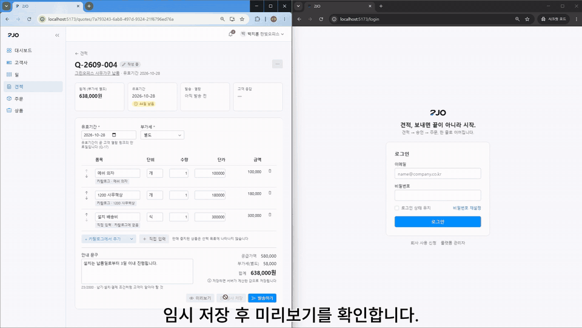

# 2JO · Deal-to-Order SaaS

> 중소 B2B 영업팀을 위한 **견적 발송·승인 추적 도구**
> 딜을 단계로 관리하고, 견적을 링크로 보내고, **계정 없는 고객**이 열람·승인한 사실을 기록으로 남기고, 승인된 견적을 주문으로 확정합니다.

이 저장소는 프로그래머스 백엔드 데브코스 10기 **최종 프로젝트의 개인 fork**입니다. 아래 "내 기여"는 제가 작성한 PR 기준입니다.

| 기간 | 팀 | 원본 저장소 |
| --- | --- | --- |
| 2026.08.26 ~ 09.15 (4주) | 백엔드 5명 | [prgrms-be-devcourse/NBE10-12-final-2JOWIN](https://github.com/prgrms-be-devcourse/NBE10-12-final-2JOWIN) |



*시연 영상 일부(1.5배속). 왼쪽은 영업 담당자, 오른쪽은 고객 화면입니다: 견적 발송 → 고객이 로그인 없이 링크로 열람(담당자에게 알림) → 승인 → 재응답 차단. 배포는 종료되었습니다.*

---

## 내 역할 한눈에 보기

팀은 도메인을 A~E로 나눠 맡았고, 저는 **D: 고객 열람·승인, 알림, 현황 대시보드**를 담당했습니다.

| 영역 | 한 일 |
| --- | --- |
| 고객 견적 열람·승인 | 열람 링크 토큰 발급·재발송·만료, 비로그인 열람·승인·반려·문의 API |
| 메일 발송 파이프라인 | 커밋 후 비동기 발송, 재시도 1회, 최종 실패 시 담당자 인앱 알림, SMTP 실발송 어댑터 |
| 배치 | 무응답 견적 리마인드, 유효기간 임박 안내 메일 |
| 인앱 알림·대시보드 | 알림 조회·읽음 API, 메일 수신 설정, 현황 대시보드 API |

---

## 구조: 모듈 경계 위에서 일하기

백엔드는 단일 Spring Boot 애플리케이션이고, **Spring Modulith의 모듈 검사(`ModularityTests`)로 도메인 간 의존을 CI에서 막았습니다.** 다른 도메인의 Repository나 엔티티에는 접근할 수 없습니다. 다만 일반적인 Modulith처럼 각 모듈이 자기 API를 공개하는 방식이 아니라, 팀은 모든 도메인의 계약 인터페이스를 `boundary` 공용 패키지 하나에 모으고 각 모듈이 그것을 구현하게 했습니다. 이렇게 한 이유와 한계는 아래 "한계와 개선한다면"에 적었습니다.

제 파트는 견적(C), 고객사(B), 회사·구성원(A) 데이터를 모두 읽어야 해서, 기능마다 **필요한 경계 계약을 먼저 정하고 상대 도메인과 합의한 뒤 구현**하는 순서로 진행했습니다. 열람 토큰 발급(`ViewTokenCommand`)과 메일 예약(`MailCommand`)은 제가 소유한 계약이라, 다른 팀원이 막히지 않도록 스텁 빈부터 먼저 올렸습니다.

---

## 핵심 기여

### 1. 계정 없는 고객이 링크 하나로 견적을 열람·승인

고객은 회원가입 없이 메일로 받은 링크만으로 견적을 보고 승인·반려·문의합니다. 링크의 토큰이 곧 인증입니다.

**토큰 설계**
- 256비트 랜덤 값을 URL-safe Base64로 만들어 링크에 싣고, **DB에는 SHA-256 해시만 저장**합니다. DB가 유출돼도 링크를 재구성할 수 없습니다.
- BCrypt를 쓰지 않은 이유: 토큰 자체가 충분히 길고 무작위라 솔트·스트레칭이 필요 없고, 솔트가 섞이면 해시로 행을 조회할 수 없기 때문입니다.
- 견적당 활성 링크는 1개(부분 유니크 인덱스)입니다. 재발송하면 기존 링크를 `RESENT`로 만료시키고 UPDATE를 먼저 flush한 뒤 새 토큰을 발급합니다.
- 토큰 발급은 견적 발송 트랜잭션(C)에 합류합니다. 발송이 롤백되면 링크도 남지 않도록 `REQUIRES_NEW`를 쓰지 않았습니다.

**열람 API의 트랜잭션 경계**
- 고객이 링크를 처음 열면 견적 상태가 `SENT → VIEWED`로 바뀌고 담당자에게 알림이 갑니다. 즉 "조회 API인데 쓰기가 섞여 있는" 구조입니다.
- 견적 담당 팀원이 리뷰에서 "열람 API를 `readOnly` 트랜잭션으로 열면 이 상태 변경이 예외도 없이 버려진다"고 짚어 줬습니다.
- 그래서 조회 자체는 **트랜잭션 없이** 각 경계 조회가 짧게 커넥션을 잡았다 놓게 하고, **첫 열람 기록만 별도 빈의 read-write 트랜잭션**으로 분리했습니다. 첫 열람 기록이 실패해도 고객의 조회는 500이 되지 않습니다.
- 통합 테스트로 "GET 후 `first_viewed_at`이 실제 PostgreSQL에 커밋된다"를 고정했습니다.

**승인·반려**
- 상태 전이 + 토큰 소진(`RESPONDED`) + 담당자 알림을 한 트랜잭션으로 묶었습니다. 한 번 응답한 링크는 열람만 되고 재응답은 막힙니다.
- 링크 만료(410), 이미 응답(409), 정지된 회사(409), 초안·회수된 견적(404)은 견적 도메인을 호출하기 전에 걸러 냅니다.

### 2. 커밋 후 비동기로 도는 메일 발송 파이프라인

견적 발송, 초대, 비밀번호 재설정 등 시스템 메일이 모두 지나가는 통로입니다. 목표는 **메일 서버가 느리거나 실패해도 사용자 요청은 영향받지 않고, 발송 결과는 반드시 기록되는 것**이었습니다.

```
호출자 트랜잭션 ── email_log(SCHEDULED) 저장 + 이벤트 발행
        │ 커밋
        ▼
AFTER_COMMIT 리스너 ── @Async 디스패처 (트랜잭션 밖에서 발송, 실패 시 1회 재시도)
                                 │
                                 ▼
                    결과만 별도 트랜잭션으로 SENT / FAILED 기록
                                 │ FAILED로 실제 전이한 경우
                                 ▼
                    담당자에게 "메일 발송 실패" 인앱 알림
```

- **커밋 후 발송**: `@TransactionalEventListener(AFTER_COMMIT)`로 받아, 롤백된 요청에서 메일이 나가지 않습니다.
- **트랜잭션 밖 호출 차단**: 예약 메서드를 `Propagation.MANDATORY`로 두었습니다. 트랜잭션 밖에서 부르면 행은 저장되는데 이벤트는 조용히 버려져 "기록은 있는데 안 나간 메일"이 생기기 때문에, 그 전에 바로 예외가 나게 했습니다.
- **발송 중 커넥션 미점유**: 처음엔 디스패처 전체를 `REQUIRES_NEW`로 감쌌습니다. 재시도(1초 대기)를 넣는 설계 리뷰에서 "네트워크 I/O와 대기 내내 DB 커넥션을 쥔다"는 지적을 받았고, 원래 트랜잭션 안에 둘 이유가 있었는지 확인한 뒤(없었습니다) 발송과 재시도를 트랜잭션 밖으로 뺐습니다. 결과 기록만 별도 빈의 `REQUIRES_NEW`로 커밋합니다.
- **재시도 기준**: 잘못된 주소처럼 다시 해도 같은 결과인 예외는 바로 실패 처리하고, 대기 중 셧다운 신호(인터럽트)가 오면 재시도를 포기합니다.
- **실패 알림**: 최종 실패를 이벤트로 발행하고 알림 모듈이 받아 담당자에게 알립니다. 실제로 FAILED로 바뀐 경우에만 발행해 중복 알림이 없습니다.
- **로그의 개인정보**: 예외 메시지에 수신자와 원문 토큰이 섞일 수 있어 예외 클래스명만 남깁니다.
- **실발송**: 개발 환경은 로그 발송기, 운영은 SMTP 어댑터를 설정값으로 바꿔 끼웁니다(AWS SES도 SMTP를 지원해 벤더에 묶이지 않게).

### 3. 매일 도는 알림 배치 2종

| 배치 | 내용 |
| --- | --- |
| 무응답 리마인드 | 발송 후 3일이 지나도록 고객 응답이 없는 견적을 담당자에게 인앱 알림 + (수신 설정이 켜진 경우) 메일 |
| 유효기간 임박 | 유효기간이 3일 이내로 남은 미응답 견적의 고객 담당자에게 안내 메일 |

- **한 건 실패가 배치 전체를 멈추지 않게**: 회사 루프와 견적 루프를 각각 격리하고, 견적 1건 처리를 `REQUIRES_NEW` 트랜잭션으로 분리했습니다.
- **다시 돌아도 한 번만**: 이미 보낸 알림·메일이 있으면 건너뛰고, `email_log`의 유니크 제약이 마지막 방어선입니다.
- 정지된 회사는 건너뜁니다. 실 PostgreSQL 통합 테스트로 정상·재실행·정지 회사·구간 경계·메일 실패 시 인앱 알림까지 확인한 뒤 cron을 켰습니다.

### 4. 그 밖에

- **인앱 알림 API**: 본인·회사 범위 조회, 미읽음 필터, 읽음·전체 읽음 처리. 다른 도메인이 알림을 만들 수 있도록 `NotificationCommand` 계약 제공
- **메일 수신 설정**: 구성원별 알림 메일 수신 여부 조회·전체 교체
- **현황 대시보드 API**: 파이프라인·이달 성사·응답 대기·최근 활동·후속 필요를 다른 도메인의 경계 조회만으로 조립(자체 테이블 없음). 영업 담당자는 본인 담당 딜만 보이고, 실적 조회는 관리자 전용

---

## 한계와 개선한다면

- **문의는 알림까지만**: 고객이 문의를 남기면 담당자에게 알림이 가지만, 문의 내용을 확인하는 화면·API는 v1 범위에서 빠졌습니다.
- **동시 첫 열람 시 알림 중복**: 두 요청이 동시에 첫 열람을 하면 "열람됨" 알림이 두 번 갈 수 있습니다. 견적 도메인의 상태 변경 메서드가 "실제로 바꿨는지"를 돌려주도록 계약을 바꿔야 해서 v1에서는 허용했습니다.
- **비동기 큐의 유실 가능성**: 메일 본문은 원문 토큰이 들어 있어 DB에 저장하지 않고 이벤트에만 실었습니다. 그래서 서버가 발송 전에 죽으면 그 메일은 다시 보낼 수 없고, FAILED로 닫는 것까지만 보장합니다.
- **SCHEDULED에 멈춘 메일**: 결과 기록마저 실패하면 행이 SCHEDULED로 남습니다. 이를 찾아내는 정체 감지 배치는 구현하지 못했습니다.
- **재시도 기준이 거침**: SMTP 5xx처럼 영구 실패를 예외 종류로 구분하지 않아, 재시도해도 소용없는 실패도 한 번 더 시도합니다.
- **계약을 `boundary` 패키지 한 곳에 모은 구조**: 발송과 링크 발급, 승인과 견적 상태 전이가 각각 한 트랜잭션이어야 해서 견적(C)과 고객 승인(D)이 서로를 동기 호출합니다. Modulith는 모듈 순환을 막기 때문에 팀은 모든 도메인의 계약 인터페이스를 공용 패키지 하나로 모아 검사를 통과시켰습니다. 그 결과 모든 모듈이 모든 도메인의 계약에 묶여, 모듈러 모놀리스의 장점인 "나중에 모듈 하나를 떼어 낼 수 있다"가 성립하지 않습니다. 멘토님께 받은 지적도 이 부분입니다. 다시 한다면 서로 이렇게 자주 부르는 견적과 고객 승인을 한 모듈로 묶는 것부터 검토하고, 각 모듈이 자기 API만 공개한 뒤 남는 역방향 호출은 이벤트나 의존성 역전으로 풀겠습니다.
- **배치는 단일 인스턴스 전제**: 서버가 여러 대가 되면 배치가 중복 실행됩니다(메일 중복은 유니크 제약이 막지만 알림 판정은 아님). 분산 락이나 ShedLock이 필요합니다.

---

## 기술 스택

| 구분 | 기술 |
| --- | --- |
| Backend | Java 21, Spring Boot 4.1, Spring Data JPA, Spring Modulith, Spring Mail, Flyway |
| Database | PostgreSQL 16 |
| 테스트·품질 | JUnit 5, Mockito, Awaitility, JaCoCo, SpotBugs |
| Infra (팀원 A 담당) | AWS(EC2, ECR, S3, SES), Terraform, Docker Compose, Caddy, GitHub Actions, Prometheus·Loki·Grafana |
| Frontend | Vite, React, TypeScript |


## 실행 방법

```bash
# 1. 로컬 PostgreSQL (포트 5433)
docker compose -f infra/dev/docker-compose.yml up -d

# 2. 백엔드 (http://localhost:8080, Swagger: /swagger-ui/index.html)
cd backend && ./gradlew bootRun --args='--spring.profiles.active=local'

# 3. 프론트엔드 (http://localhost:5173)
cd frontend && npm install && npm run dev
```

local 프로필로 띄우면 시연 데이터가 자동으로 들어갑니다. 시연 계정은 `jihun@hanbit.co.kr` / `test1234!`(영업 담당)입니다. 기획·설계 문서는 [docs/](docs/README.md)에 있습니다.

## 팀

| 담당 | 이름 | 도메인 |
| --- | --- | --- |
| A | 조민석 | 온보딩 · 구성원 · 인증, 인프라 |
| B | 한상민 | 고객사 · 상품 카탈로그 · 활동 이력 |
| C | 최선진 | 딜 · 견적 · 주문 |
| **D** | **이준형** | **고객 열람·승인 · 알림 · 현황 대시보드** |
| E | 김대연 | 공통 기반(에러·보안·비동기 설정) |

## 관련 PR

| 영역 | PR |
| --- | --- |
| 열람 링크 토큰 | [#15](https://github.com/prgrms-be-devcourse/NBE10-12-final-2JOWIN/pull/15) · [#31](https://github.com/prgrms-be-devcourse/NBE10-12-final-2JOWIN/pull/31) · [#35](https://github.com/prgrms-be-devcourse/NBE10-12-final-2JOWIN/pull/35) · [#54](https://github.com/prgrms-be-devcourse/NBE10-12-final-2JOWIN/pull/54) |
| 고객 열람·승인·반려·문의 API | [#156](https://github.com/prgrms-be-devcourse/NBE10-12-final-2JOWIN/pull/156) · [#166](https://github.com/prgrms-be-devcourse/NBE10-12-final-2JOWIN/pull/166) |
| 메일 발송 파이프라인 | [#47](https://github.com/prgrms-be-devcourse/NBE10-12-final-2JOWIN/pull/47) · [#69](https://github.com/prgrms-be-devcourse/NBE10-12-final-2JOWIN/pull/69) · [#118](https://github.com/prgrms-be-devcourse/NBE10-12-final-2JOWIN/pull/118) · [#213](https://github.com/prgrms-be-devcourse/NBE10-12-final-2JOWIN/pull/213) · [#325](https://github.com/prgrms-be-devcourse/NBE10-12-final-2JOWIN/pull/325) |
| 알림 배치 | [#243](https://github.com/prgrms-be-devcourse/NBE10-12-final-2JOWIN/pull/243) · [#323](https://github.com/prgrms-be-devcourse/NBE10-12-final-2JOWIN/pull/323) |
| 인앱 알림·수신 설정 | [#78](https://github.com/prgrms-be-devcourse/NBE10-12-final-2JOWIN/pull/78) · [#132](https://github.com/prgrms-be-devcourse/NBE10-12-final-2JOWIN/pull/132) |
| 현황 대시보드 | [#211](https://github.com/prgrms-be-devcourse/NBE10-12-final-2JOWIN/pull/211) |
